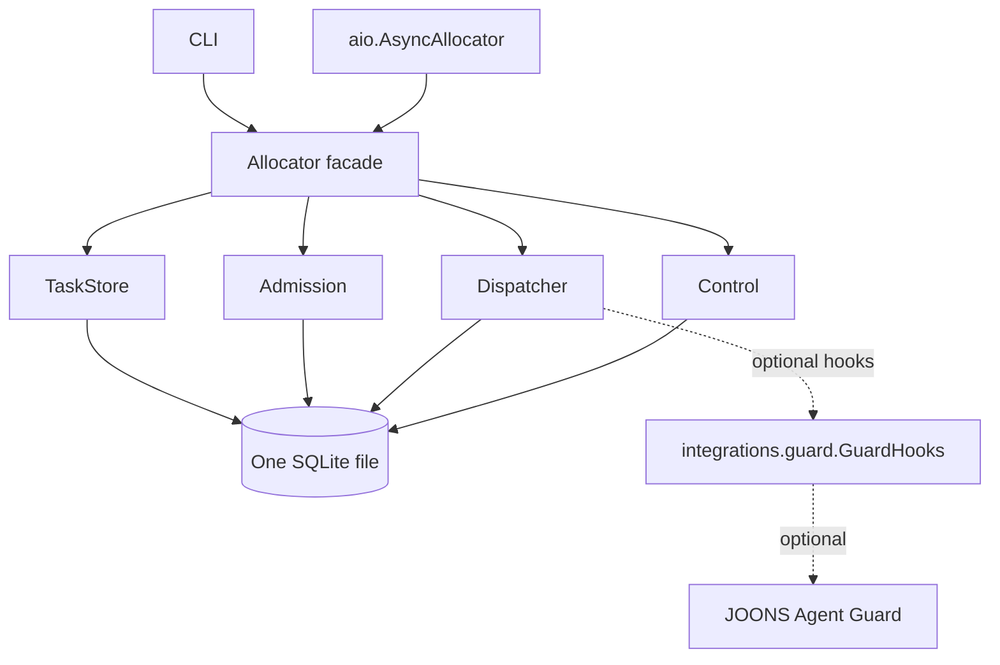
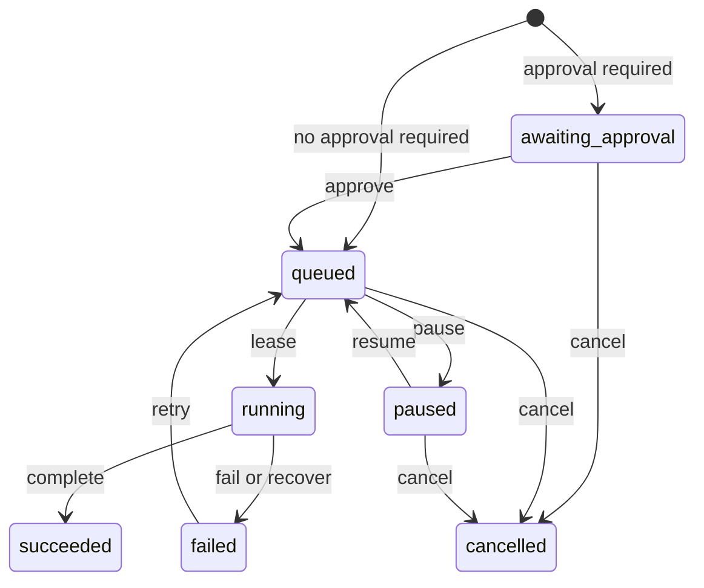

# JOONS Allocator 0.1.0 Preview architecture

This document describes the implemented 0.1.0 Preview contract. Items marked Planned are not implemented.

## Purpose and scope

JOONS Allocator provides lightweight task registration, allocation, queue management, and progress tracking for AI agents on a single machine. One allocator owns one SQLite file; the package requires Python 3.9 or later and only the standard library. There is no server or distributed mode. JOONS Agent Guard is optional.

## Components

- `Allocator` is the facade: it owns the database file and composes the public component classes into one API.
- `TaskStore` persists and reads tasks and supports guarded state changes.
- `Admission` registers tasks and handles idempotent submission.
- `Dispatcher` leases tasks to workers and settles or recovers leases.
- `Control` applies operator decisions and records their audit events atomically with the decisions.
- `aio.AsyncAllocator` wraps the facade using `to_thread`, shielding and in-flight tracking; `aclose()` waits for in-flight work. Cancellation compensation is implemented.
- The CLI exposes submission, inspection, queue and worker views, and operator actions. Read commands use a read-only SQLite connection; operator actions require `--yes`.
- `integrations.guard.GuardHooks` is an optional adapter accepted by a Dispatcher as `hooks=`. It lazily imports JOONS Agent Guard and raises a clear `ImportError` when used without that package.

## SQLite data model

All allocator state is in one SQLite file. Each state change uses one `BEGIN IMMEDIATE` transaction. Connections use autocommit and a per-connection reentrant lock; nested writes are refused. A failed transaction rolls back when active and preserves the original exception.

### `tasks`

| Column | Purpose |
|---|---|
| `task_id` | Identifies the task. |
| `state` | Records its lifecycle state. |
| `payload` | Stores the submission as canonical JSON. |
| `result` | Stores the task result or failure information. |
| `priority` | Controls allocation order; integer, default 0. |
| `resource` | Optional resource name used for exclusive allocation. |
| `worker_id` | Identifies the worker holding the current lease, if any. |
| `lease_token` | Identifies the current lease for guarded operations. |
| `created` | Records creation time for FIFO ordering among equal priorities. |
| `updated` | Records the latest update time. |
| `version` | Tracks the row version for guarded state changes. |

### `submissions`

| Column | Purpose |
|---|---|
| `principal` | Identifies the submitting principal; part of the composite primary key. |
| `request_id` | Identifies the request within the principal; part of the composite primary key. |
| `digest` | Records the digest used to compare repeated submissions. |
| `task_id` | Identifies the task created for the request. |
| `created` | Records when the submission was created. |

### `workers`

| Column | Purpose |
|---|---|
| `worker_id` | Primary key identifying the worker. |
| `registered` | Records registration time. |
| `last_seen` | Records the worker's most recent observed activity. |
| `current_task` | Identifies its current task, or is null when its slot is free. |
| `consecutive_failures` | Records consecutive failures for worker bookkeeping. |
| `paused` | Indicates whether allocation to the worker is paused. |

### `task_audit`

This append-only table records operator decisions, including recovery, in the same transaction as the state change. Columns are `id`, `task_id`, `action`, `before_state`, `after_state`, `decided_by`, `note`, and `ts`.

## Task state machine

Only a lease enters `running`, with a lease token. Recovery fails a running lease; retry is the only transition from `failed` to `queued`.

## Lease algorithm

For `lease(worker_id)`:

1. Start one `BEGIN IMMEDIATE` transaction. Register a new worker if needed.
2. Check that the worker is not paused and its slot is free. If not, return no task.
3. Consider queued tasks in `priority DESC, created ASC` order. Skip a task when another running task holds its non-null resource.
4. Apply the optional pre-lease hook; a veto skips that lease. A missing hook allows the candidate; lookup or callback errors are logged and veto it.
5. Claim an eligible task as `running`, assign the worker and a lease token, and occupy the worker slot in the same transaction. If none is eligible, return no task.
6. Commit before any `after_*` hook. Return the leased task, or `None` if no task was leased.

The transaction makes the worker-slot and resource checks atomic with the claim. `queue()` returns queued tasks in the same priority and creation-time order; ties use task ID.

## Idempotent submission

The task row and its submission record are written in one transaction. For a given `(principal, request_id)`, a new request is `accepted`; the same digest is `duplicate` and returns the original task ID; a different digest is `conflict` and writes nothing. There is no `pending` outcome or separate reconciliation or abort protocol. An omitted task ID is generated as a UUID4 hex string.

## Crash and recovery

SQLite commits the allocator's state change as a unit; an interrupted uncommitted transaction rolls back. Running tasks never expire automatically. A dead worker can therefore leave a task running until an operator explicitly calls `recover(task_id, expected_worker, decided_by, note="", *, lease_token=token)`. Recovery checks the supplied worker and lease token; the transition, worker slot, and audit record commit in the same transaction. Complete and fail require the leased Task or its ID and token. Recovery does not itself retry the task.

## Optional Guard hooks

`GuardHooks(circuit=None, locks=None)` adds optional Guard behavior without making Guard a core dependency. Before a lease is handed out, `circuit.begin(worker_id, task_id)` may veto it by returning false; when a task has a resource and locks are configured, the adapter calls `locks.acquire(resource, worker_id, task_id)`. On completion, failure, or recovery the adapter releases or finishes the corresponding Guard state.

`before_lease(worker_id, task)` runs inside the SQLite write transaction and may veto a candidate; lookup or callback errors are logged and veto it. It must not call the allocator or block for long, because the write transaction is held. `after_lease(worker_id, task)`, `after_settle(worker_id, task, success)`, and `after_recover(worker_id, task)` run after commit; lookup and callback errors are logged. External hook side effects are not rolled back by SQLite. Hooks should be idempotent and external state reconciled when needed, including through `GuardHooks.after_recover` and its `break_lock` call. Core resource exclusivity and worker-slot enforcement remain in SQLite and do not depend on Guard.

## Responsibilities

| Concern | JOONS Allocator | JOONS Agent Guard |
|---|---|---|
| Task registration | Creates tasks and provides submission idempotency. | Provides replay protection as a separate Guard capability. |
| Allocation and queue | Orders queued tasks and assigns eligible tasks to free workers. | Provides optional circuit breaking. |
| Resources | Enforces resource exclusivity among running tasks in its database. | Provides optional locks. |
| Progress | Records task states, results, worker information, and operator audit. | Provides Guard-specific protection and bookkeeping. |

## Deliberately out of scope

Planned, out of scope for 0.1.0: multi-machine or network coordination; task timeouts with automatic expiry; scheduled or delayed tasks; task dependencies; worker capacity greater than one; and a web UI.

RESULT: task=D1 status=done files=ARCHITECTURE.md